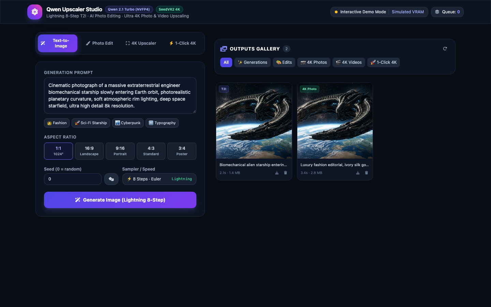
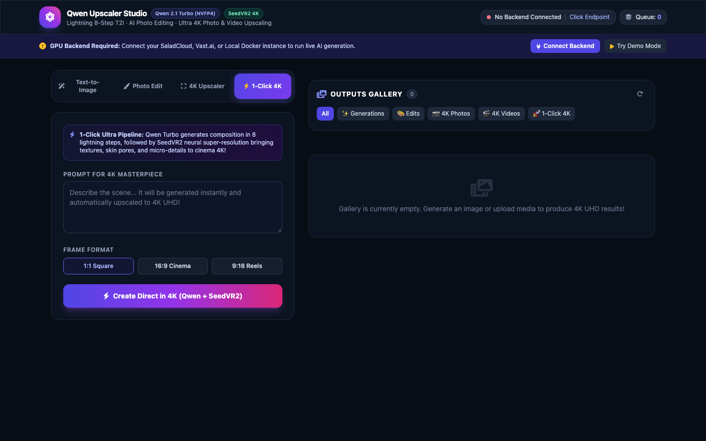
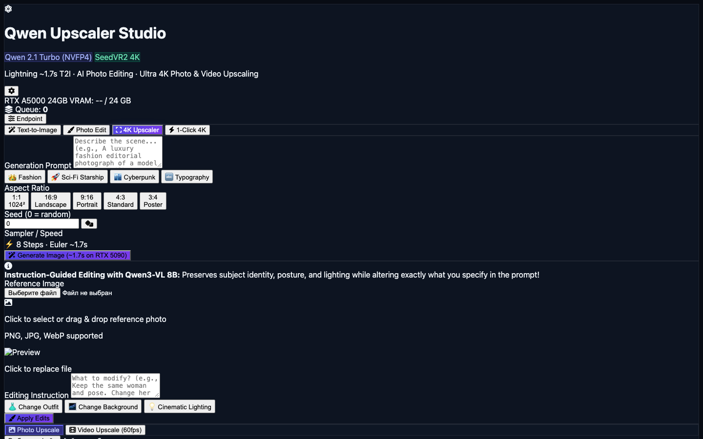
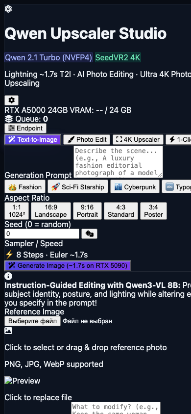
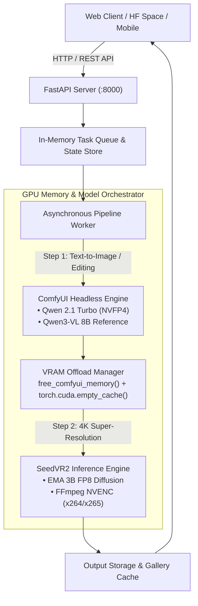

<div align="center">

# ⚡ Qwen 2.1 Turbo + SeedVR2 4K Studio

**Self-Hosted, Production-Grade AI Creative Suite: Lightning 8-Step Text-to-Image, Vision-Language Photo Editing, and Cinema 4K Neural Super-Resolution.**

[](https://opensource.org/licenses/Apache-2.0)
[](https://hub.docker.com/r/s3rfdev/qwen-turbo-upscaler)
[](https://huggingface.co/spaces/s3rfdev/qwen_upscaler)
[](https://developer.nvidia.com/cuda-toolkit)
[](https://pytorch.org/)
[](https://nvidia.com)

<p align="center">
  <a href="#-key-features">Key Features</a> •
  <a href="#-live-web-interface">Web Interface</a> •
  <a href="#-finops--hardware-benchmarks">FinOps Benchmarks</a> •
  <a href="#-architecture">Architecture</a> •
  <a href="#-quick-start--deployment">Deployment</a> •
  <a href="#-rest-api-reference">REST API</a>
</p>



</div>

---

## 💡 What is Qwen Upscaler Studio?

**Qwen Upscaler Studio** is an all-in-one open-source production stack that unifies state-of-the-art vision and diffusion models into an optimized containerized workflow:

1. **Qwen 2.1 Turbo (NVFP4 Quantization)**: Distilled 8-step lightning text-to-image generator producing photorealistic anatomical accuracy, complex lighting, and typography in just seconds on any modern GPU.
2. **Qwen3-VL 8B Reference Conditioning**: Multimodal instruction-guided image editing. Modify clothing, backgrounds, or cinematic lighting while strictly preserving subject facial identity, pose, and physical proportions.
3. **SeedVR2 (EMA 3B FP8)**: State-of-the-art temporal diffusion super-resolution model for upscaling photography and video up to **4K UHD (2160p 60fps)** with perceptual reconstruction and color matching.
4. **1-Click 4K Combo Pipeline**: Generate a fresh concept with Qwen Turbo and upscale it directly into fine 4K micro-textures through an automated orchestration pipeline with intelligent VRAM offloading.

---

## ✨ Key Features

- **⚡ Instant 8-Step Synthesis**: Photorealistic generation in 8 distilled steps, saving up to 90% in cloud GPU compute costs compared to traditional 30-50 step diffusion models across any modern NVIDIA GPU.
- **🔍 4K Photo & Video Super-Resolution**: Upscale static imagery or 60fps videos using temporal window tiling, FP8 attention, and customized FFmpeg NVENC acceleration.
- **🔄 Zero-OOM VRAM Orchestrator**: Runs both ComfyUI diffusion graphs and SeedVR2 super-resolution inside a single 24GB VRAM envelope via dynamic memory flushing (`free_comfyui_memory()` + PyTorch CUDA cache clearing).
- **📱 Fully Responsive Modern UI**: Built with Tailwind CSS, dark glassmorphism, prompt presets, seed controls, real-time GPU telemetry, and an outputs gallery. Adapts seamlessly to mobile viewports.
- **☁️ Multi-Cloud Native**: 1-click turnkey deployment on [SaladCloud](https://salad.com), [Vast.ai](https://vast.ai), local NVIDIA workstations, or as a standalone [Hugging Face Space](https://huggingface.co/spaces/s3rfdev/qwen_upscaler).
- **🔒 Zero-Setup Container**: All weights, compiled CUDA kernels, dependencies, and web services are pre-baked into `s3rfdev/qwen-turbo-upscaler:latest`. Just run and generate!

---

## 🖼️ Live Web Interface & Gallery

| **1-Click 4K Combo Pipeline** | **SeedVR2 4K Super-Resolution** |
| :---: | :---: |
|  |  |

| **Mobile Viewport (Responsive)** | **Sample Photorealistic Output** |
| :---: | :---: |
|  |  |

---

## 📊 FinOps & Hardware Benchmarks

### Cost per 1,000 Images Across Cloud GPUs

| GPU Model | VRAM | Architecture | Hourly Rate (SaladCloud) | Inference Time (T2I 1024²) | Cost / 1,000 Images | Cost Efficiency Rating |
| :--- | :---: | :---: | :---: | :---: | :---: | :---: |
| **NVIDIA RTX A5000** | **24 GB** | **Ampere** | **$0.18 / hr** | **3.2s** | **$0.160** | 🏆 **Best Value (Cost Leader)** |
| **NVIDIA RTX 3090 Ti**| **24 GB** | **Ampere** | **$0.19 / hr** | **3.0s** | **$0.158** | 🥈 **Excellent High-Throughput** |
| **NVIDIA RTX 4090** | **24 GB** | **Ada Lovelace**| **$0.34 / hr** | **2.5s** | **$0.236** | ⚡ **Fast Turnaround** |
| **NVIDIA RTX 5090** | **32 GB** | **Blackwell** | **$0.48 / hr** | **1.7s** | **$0.226** | 🚀 **Speed Champion (Sub-2s)** |

> [!TIP]
> **Why Cloud Desktop GPUs Beat High-End Laptops:**
> Mobile laptop GPUs (e.g., RTX 4090 Mobile) are constrained by tight thermal limits (115W–175W TGP) and narrow 16GB VRAM buses, causing thermal throttling and memory offloading during 4K super-resolution passes. Cloud desktop cards (RTX A5000 / 3090 Ti / 4090) operate at 300W–450W with 24GB+ unconstrained GDDR6X/ECC memory, providing consistent, sustained high-throughput generation.

---

## 🏗️ Architecture



---

## 🚀 Quick Start & Deployment

### Option A: 1-Click SaladCloud Deployment (Recommended)

SaladCloud offers enterprise-grade consumer and workstation GPUs at wholesale spot prices (~$0.18/hr).

1. **Clone the repository:**
   ```bash
   git clone https://github.com/s3rfdev/qwen_upscaler.git
   cd qwen_upscaler
   ```

2. **Configure your API keys:**
   ```bash
   cp .env.example .env
   ```
   Add your `SALAD_API_KEY` and `SALAD_ORGANIZATION_NAME` from [Salad Portal](https://portal.salad.com/api-keys).

3. **Deploy using the included CLI:**
   ```bash
   # Deploy on cost-effective RTX A5000 24GB
   python ctl.py salad up --gpu rtx_a5000

   # Check status and retrieve public endpoint
   python ctl.py salad status
   ```

4. Once running, open the URL returned by `python ctl.py salad status` in your browser.

---

### Option B: Local Workstation (Docker Compose)

For local development on an NVIDIA GPU (24GB+ VRAM recommended):

```bash
docker compose up -d
```
Open [http://localhost:8000](http://localhost:8000) in your web browser.

Alternatively, with Docker CLI:
```bash
docker run --gpus all \
  -d --restart unless-stopped \
  -p 8000:8000 \
  --name qwen-turbo-upscaler \
  s3rfdev/qwen-turbo-upscaler:latest
```

---

### Option C: Vast.ai Deployment

1. Install Vast CLI: `pip install vastai`
2. Search and create an instance:
   ```bash
   vastai create instance <OFFER_ID> \
     --image s3rfdev/qwen-turbo-upscaler:latest \
     --disk 80 \
     --env '-p 8000:8000 -e PORT=8000' \
     --onstart-cmd "/app/start.sh"
   ```

---

### Option D: Hugging Face Space Connection (Web Client)

A live web client is hosted at [huggingface.co/spaces/s3rfdev/qwen_upscaler](https://huggingface.co/spaces/s3rfdev/qwen_upscaler).

> [!NOTE]
> **Why the Space requires a GPU backend:**
> Generating 4K imagery and neural super-resolution requires a 24GB+ GPU. To keep public hosting 100% free without incurring Hugging Face's expensive $1.05/hr GPU billing, this Space operates as a decoupled frontend client.
>
> 1. **Interactive Demo Mode:** Click **Try Demo Mode** in the header banner to explore the interface, inspect gallery outputs, and simulate generations.
> 2. **Live GPU Generation:** Click **Endpoint** in the header, paste your deployed SaladCloud, Vast.ai, or Local Docker address (e.g. `https://your-node.salad.net`), and start generating instantly.

---

## 🛠️ Configuration (`.env`)

| Variable | Description | Default |
| :--- | :--- | :--- |
| `SALAD_API_KEY` | Your SaladCloud API access token | `None` |
| `SALAD_ORGANIZATION_NAME` | Your SaladCloud organization name | `None` |
| `SALAD_PROJECT_NAME` | SaladCloud project identifier | `default` |
| `SALAD_CONTAINER_NAME` | Container group name | `qwen-turbo-upscaler` |
| `SALAD_GPU_CLASS` | Target hardware (`rtx_a5000`, `rtx_3090_ti`, `rtx_4090`, `rtx_5090`) | `rtx_a5000` |
| `HF_TOKEN` | Hugging Face User Access Token (Write) | `None` |
| `BACKEND_API_URL` | Remote API URL for frontend connection | `http://localhost:8000` |

---

## 📡 REST API Reference

The container exposes a standard FastAPI backend for easy programmatic integration:

### 1. Text-to-Image Generation
```bash
curl -X POST http://localhost:8000/api/generate \
  -F "prompt=Futuristic cyberpunk architecture, neon reflections, rain, 85mm cinematic photo" \
  -F "width=1024" \
  -F "height=1024" \
  -F "seed=42"
```
**Response:**
```json
{
  "job_id": "gen_1791640822",
  "status": "queued",
  "message": "Generation job submitted successfully"
}
```

### 2. Instruction-Guided Image Editing
```bash
curl -X POST http://localhost:8000/api/edit \
  -F "file=@portrait.png" \
  -F "prompt=Keep the exact person and pose. Change dress color to royal blue satin."
```

### 3. SeedVR2 4K Super-Resolution
```bash
curl -X POST http://localhost:8000/api/upscale \
  -F "file=@image.png" \
  -F "media_type=image" \
  -F "resolution=2160"
```

### 4. 1-Click 4K Combo Pipeline
```bash
curl -X POST http://localhost:8000/api/combo \
  -F "prompt=A luxury fashion editorial photograph, ivory silk gown, brutalist architecture" \
  -F "width=1024" \
  -F "height=1024"
```

### 5. Telemetry & GPU Stats
```bash
curl http://localhost:8000/api/stats
```
**Response:**
```json
{
  "gpu": {
    "name": "NVIDIA RTX A5000",
    "total_gb": 24.0,
    "free_gb": 21.8,
    "allocated_gb": 2.2
  },
  "queue_count": 0,
  "active_jobs": 0
}
```

---

## 🤝 Contributing & License

Contributions, issues, and feature requests are welcome!

Distributed under the **Apache 2.0 License**. See [LICENSE](LICENSE) for details.

Developed with ❤️ by [s3rfdev](https://github.com/s3rfdev).
